<h3 align="center">
  Offensive Security &amp; Reverse Engineering | Applied Cryptography | AI-Native Engineering
</h3>

  4th-year Computer Engineering Student · <code>127.0.0.1</code>

  <code>$ whoami --type</code> → <code>INTP-A</code>

---

## 👨‍💻 About Me

I’m a fourth-year Computer Engineering student working where **offensive security, reverse engineering, applied cryptography, and AI-native engineering** meet.

I’m interested in how systems fail, from web applications and security boundaries to low-level software and compiled binaries. My work spans web security, penetration testing, red team practices, and vulnerability research. I’m also part of the **SiberVatan | Yavuzlar Red Team**, focused on **Web Security**.

I build the systems I want to understand: fail-closed network gateways, hardware-bound vaults, end-to-end encrypted messengers, and agent platforms that run real security tooling.

Syntax is no longer the bottleneck. What matters is knowing what to build, how it breaks, and how to prove that it does not, then directing agents to write it inside a token budget. I work as the architect and the adversary. The models are the hands.

---

## 📈 Skill Map

  

  Scored by Claude Fable 5.2, not by me, after it reviewed my repositories and three months of our working sessions. An AI reading of the evidence, not a certification.

---

## 🧠 Operating Doctrine

I do not prompt and hope. Every model that works for me first loads my own rules, guidelines, and agent skills: a written doctrine that fixes who decides, who writes, the order in which work is hardened, and what is allowed to ship.

  

---

## 🛠️ Arsenal

### Languages

  
  
  
  
  
  

### AI & Agentic Development

  
  
  
  
  
  

### Systems & Application Development

  
  
  
  
  
  
  
  

## 🌐 Connect With Me

  <a href="https://www.linkedin.com/in/ahmetberattang%C3%BCner/">
    <!-- icon:linkedin -->
  </a>
  

---

  <em>I design systems, break them, reverse engineer them, and direct AI to build better ones.</em>

